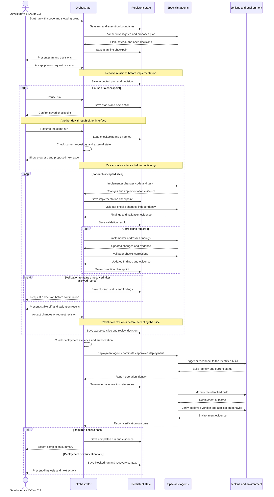

# Local Agentic SDLC: Conceptual Plan

Status: Proposal for further design

## 1. Goal and scope

Build a local workflow that guides developers through the software development life cycle (SDLC), from planning through deployment to lower environments.

Developers must be able to stop at any stage and resume on another day. They must retain the plan, decisions, changes, evidence, and next action. They must also be able to switch between IntelliJ Copilot Chat and Copilot CLI during the same run.

Both interfaces are required in the first release. Neither interface is a secondary path or a later enhancement.

The existing ai-context component catalog distributes agents, skills, instructions, and related workflow guidance. Existing language instructions and the maintainable-code skill remain the shared standards.

The initial scope covers one developer using one local machine, with work continuing across sessions and machine restarts. Cross-device synchronization and shared ownership can follow later. Local execution does not imply that Copilot model inference works offline.

## 2. Core design

Use one local orchestrator with persistent workflow state. IntelliJ Chat and CLI act as two interfaces to the same workflow.

The orchestrator controls stage order, checks completion conditions, records decisions, and coordinates agent work. Persistent state preserves the information needed to resume and recover.

These are separate responsibilities, but they can belong to one small application. The initial design does not require a separate state service or a general-purpose workflow platform.

| Component | Responsibility |
| --- | --- |
| ai-context catalog | Distribute versioned agents, skills, instructions, and workflow guidance. |
| IntelliJ and CLI interfaces | Start runs, show progress, collect decisions, request pauses, and resume work. |
| Orchestrator | Select the next stage, coordinate agents, enforce transitions, and manage recovery. |
| Persistent state | Preserve the run record, checkpoints, decisions, outputs, and external operation references. |
| Specialist agents | Perform planning, implementation, validation, and deployment investigation. |
| Jenkins and application checks | Execute established delivery processes and provide deployment evidence. |

The saved run record is authoritative. Chat history supports the workflow but does not determine its current state.

Agents can recommend a transition. The orchestrator checks whether the required evidence and authorization support that transition. A conversational claim of success does not complete a stage.

### Conceptual interaction flow

The diagram shows one run from planning through deployment. The developer can use IntelliJ Chat or CLI for each interaction.

The agents share a participant column for readability. Planning, implementation, validation, and deployment still use separate specialist roles and contexts.

The pause example appears after planning, but the same behavior applies at each checkpoint. A pause during active work follows the recovery rules below.

All agent results return through the orchestrator. The orchestrator saves evidence and controls the next assignment. Agents do not transfer workflow ownership directly.

The deployment messages summarize an ongoing exchange. Save operation references as they become available, before waiting for completion. Resumption reconnects to existing external work.

## 3. Workflow and agent responsibilities

Start with sequential work and bounded correction loops. Each stage can end at a checkpoint chosen by the developer.

| Stage | Main responsibility | Completion evidence |
| --- | --- | --- |
| Setup | Identify the requirement, repository, target environment, and intended stopping point. | Saved scope, applicable standards, and execution boundaries. |
| Planning | Investigate the repository and define acceptance criteria and manageable implementation slices. | Reviewed plan, verification approach, and resolved blocking decisions. |
| Implementation | Complete an accepted slice using repository conventions and maintainable-code. | Code changes, relevant tests, and recorded deviations. |
| Validation | Independently inspect the changes against requirements and quality expectations. | Findings, executed checks, and acceptance-criteria evidence. |
| Developer review | Present a coherent diff and let the developer accept or request changes. | Recorded decision linked to the reviewed changes. |
| Deployment | Use an established Jenkins process for the selected lower environment. | Build identity, artifact identity, deployment outcome, and environment. |
| Environment verification | Confirm the expected version and required application behavior. | Version confirmation, readiness checks, and relevant smoke-test results. |

The planner identifies unclear requirements before implementation starts. The implementer records material departures from the plan and returns them for review.

The validator uses a separate context. It inspects the actual changes and original acceptance criteria, as well as the implementation summary. It returns findings to the implementer when corrections are necessary.

The deployment agent initially operates established pipelines. Pipeline creation or modification follows the same planning, implementation, and validation process as other code changes.

The orchestrator limits correction attempts. Repeated failures cause a pause with the remaining findings and suggested next actions.

## 4. Persistent state and checkpoints

Each run needs a stable identity and a readable status summary. The run must survive closure of chat, termination of the agent session, and restart of the local application or machine.

| Saved information | Purpose |
| --- | --- |
| Requirement, scope, and acceptance criteria | Preserve what the developer intends to deliver. |
| Plan, slices, and decisions | Preserve the agreed approach and its rationale. |
| Current stage, status, and next action | Make resumption clear. |
| Repository and work context | Identify the correct branch or worktree and relevant code revision. |
| Changes and validation evidence | Establish what was implemented and checked. |
| Checkpoints and decision history | Explain how the run reached its current state. |
| Agent, instruction, and skill versions | Keep the guidance for an active run consistent. |
| Jenkins and artifact references | Reconnect to external work without repeating it. |
| Pending actions and unresolved outcomes | Support recovery when execution stops unexpectedly. |

Record statuses such as ready, running, waiting for review, paused, blocked, interrupted, completed, and canceled. Show both the stage and status so developers can distinguish a paused implementation from a failed deployment.

Save checkpoints after stage completion, developer decisions, and meaningful progress within long stages. Record external operation intent and identifiers as soon as they become available.

Preserve local code changes as well as workflow metadata. An interrupted stage can contain useful partial work even when its completion conditions remain unmet.

Keep credentials outside the run record. Store references to evidence and execution context without copying secrets into summaries or logs.

## 5. Pause, resume, and recovery

A developer can request a pause immediately or after a selected stage. If an operation cannot stop immediately, show that a pause is pending.

Pausing the local workflow does not automatically cancel a Jenkins build. Show which external operations remain active. Treat workflow cancellation and external build cancellation as separate actions.

On resume, present a short briefing containing:

- The goal and current stage.
- Completed work and its evidence.
- The last checkpoint and any partial work.
- Outstanding findings or decisions.
- External operations that remain active or have uncertain outcomes.
- The proposed next action.

Before continuation, compare the saved context with the current repository and environment. Manual edits, branch changes, or newer deployments can make earlier evidence stale.

Repeat only the checks affected by a change. Return to planning when changed requirements or repository conditions invalidate the accepted approach. Preserve earlier evidence as history while marking it as superseded.

Reconnect to an existing Jenkins run after interruption. If a deployment request has an uncertain outcome, establish what happened before submitting another request.

Only one interface can control an active run at a time. The other interface can inspect progress. Switching interfaces transfers control without starting duplicate work.

A new agent session must be able to continue from saved state and repository evidence. Recovery must not depend on restoring the original model context.

## 6. IntelliJ and CLI experience

Both interfaces use the same stage definitions, state, decisions, and completion rules. Interface-specific behavior is limited to presentation and interaction.

| Capability | IntelliJ Copilot Chat | Copilot CLI |
| --- | --- | --- |
| Start or resume | Select a run through chat. | Select a run through the terminal. |
| Review the plan | Read and discuss the plan in the IDE. | Read and discuss the same plan in the terminal. |
| Monitor work | Show stages, progress, and pending decisions. | Show equivalent status and decisions. |
| Review changes | Use the IDE diff experience. | Inspect changes in the terminal or open them in IntelliJ. |
| Pause or cancel | Send the request from chat. | Send the request from the terminal. |
| Continue elsewhere | Resume a CLI-originated run. | Resume an IDE-originated run. |

Developers must not need to copy chat transcripts between interfaces. A run must keep the same identity and history when its interface changes.

Make human review a stable checkpoint. Stop agent edits during review so the diff remains consistent. Manual corrections trigger validation of the affected changes.

Confirm the supported IntelliJ plugin and CLI versions during initial design. Verify the integration needed to reach the shared orchestrator from each interface.

If native chat lacks a required operation, provide an integration to the same orchestrator. Requiring IDE users to complete workflow control in a terminal does not satisfy IDE support.

## 7. Deployment boundaries

At setup, define the intended lower environment and the stages authorized to run automatically. Preserve those decisions across sessions while their scope remains valid.

Revisit authorization when the target, artifact, or operation materially changes. Avoid repeating unchanged approval requests solely because the developer resumed on another day.

Deployment completion requires evidence that the intended artifact reached the intended environment. A successful Jenkins result alone does not establish correct application behavior.

If deployment or environment verification fails, preserve the result and provide a diagnosis. Corrective deployment and rollback follow the agreed environment rules. Repeated deployment attempts are not a general recovery strategy.

Existing repository, Jenkins, and environment permissions remain in effect. The workflow does not imply permission to merge protected branches or deploy to additional environments.

## 8. Distribution and repository adoption

Continue using ai-context as the component catalog. Distribute a compatible set of agents, skills, instructions, and workflow guidance for each release.

Keep active runs associated with the component versions they started with. Apply updates to new runs by default. Make changes to an active run's guidance explicit.

Each participating repository supplies a small operational profile: its build and test expectations, Jenkins process, lower environments, and application checks. The shared workflow uses that profile without duplicating language standards.

Check that both interfaces discover the intended agents and standards. Include explicit application of maintainable-code in planning, implementation, and validation.

## 9. Delivery phases

Both interfaces participate in every phase. Passing one interface does not permit deferring the other.

| Phase | Outcome | Exit condition |
| --- | --- | --- |
| Shared workflow foundation | Define stages, saved state, checkpoints, and interface integration. | Create, pause, and resume a sample run through both interfaces, including after restart. |
| Planning through validation | Add specialist agents and developer review. | Complete representative Java and Python changes with saved plans, diffs, and evidence. |
| Lower-environment deployment | Connect established Jenkins processes and application checks. | Resume external work without duplicate deployment and verify the intended artifact. |
| Pilot and refinement | Exercise normal work, interruptions, and recovery. | Both interfaces and cross-interface continuation meet the acceptance criteria. |

Use one Java repository and one Python repository for the initial pilot. Expand after the workflow demonstrates useful results and reliable recovery.

## 10. Acceptance and evaluation

Use a common acceptance suite for both interfaces. Test user-visible behavior and recovery outcomes rather than internal implementation choices.

| Scenario | Required result |
| --- | --- |
| Pause at every stage and resume another day | The run retains its work, decisions, evidence, and next action. |
| Start in IntelliJ and resume in CLI | The same run continues without manual context transfer. |
| Start in CLI and resume in IntelliJ | The same run continues with IDE review available. |
| Close the agent or restart the machine mid-stage | The run identifies partial work and supports controlled continuation. |
| Edit code manually or change branches while paused | The workflow detects changed context and revisits affected evidence. |
| Resume while Jenkins is running or after it finishes | The workflow retrieves the existing outcome without a duplicate trigger. |
| Lose the response to a deployment request | The workflow resolves the uncertain outcome before any retry. |
| Open the same run in both interfaces | Only one controller advances or mutates the run. |
| Update catalog components during a paused run | The run retains its recorded versions or records an explicit update. |
| Encounter repeated validation failures | The workflow pauses with specific findings and useful next actions. |
| Cancel while external work is active | The workflow distinguishes canceled local work from external execution. |

Measure acceptance-criteria completion, developer corrections, validation misses, recovery success, elapsed time, and model usage. Compare results with normal developer-led work in the same repositories.

The first release succeeds when developers can complete and resume the full workflow through either interface, with reliable evidence and no duplicate external actions.

## 11. Decisions for detailed design

- Select how IntelliJ Chat and CLI connect to the shared orchestrator.
- Choose the local persistence approach and recovery guarantees.
- Define checkpoint frequency and handling of partial code changes.
- Define review boundaries and authorization for lower environments.
- Agree on evidence requirements for each participating repository.
- Define component compatibility, retention, and local backup expectations.
- Decide whether an existing local application should host the orchestrator.

Keep these choices within the agreed scope. Distributed execution, cross-device synchronization, and a general workflow designer are future considerations.

---

Writing review: Reviewed for ASD-STE100 alignment. The official dictionary was not available.
